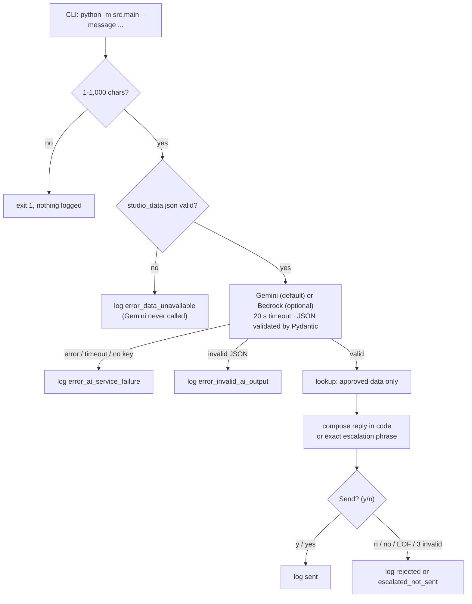

# FitDesk Enquiry Assistant — RAHN Jan 2027 Assessment

**Hours spent:** 4 hours.

A command-line AI enquiry assistant for a small fitness studio in Hermanus. It follows RAHN's
6-layer agent framework and the two non-negotiable rules, **No Invented Data** and
**Human-in-the-Loop**:

1. Accepts one customer enquiry from the command line (1–1,000 characters).
2. Sends it to Gemini, which returns **structured JSON** (`intent`, `details`,
   `requires_human_approval`) validated with **Pydantic**.
3. Looks up facts only in the approved file [data/studio_data.json](data/studio_data.json), which
   is validated on load.
4. Composes the reply **in code** from those facts. If any fact is missing, it uses exactly
   `"I'll check with the owner and come back to you."`
5. Asks staff `Send? (y/n)`. Only an explicit yes is recorded as `sent`.
6. Appends every outcome to `status_log.json`.

---

## Architecture

Gemini only classifies *what was asked*. It never sees or writes a price or slot, so an
instruction hidden in a customer message cannot put an invented fact into a reply.



Plain-text view:

```
message ─> validate ─> load+validate data ─> Gemini JSON ─> Pydantic ─> lookup ─> draft ─> Send? (y/n)
              │x              │x                  │x             │x                          │y    │n
              v               v                   v              v                           v     v
           exit 1   error_data_unavailable  error_ai_service  error_invalid           sent  rejected /
                                            _failure          _ai_output                    escalated_not_sent
```

| RAHN layer | Where |
|---|---|
| 01 Data ingestion | `src/main.py` (CLI), `src/data_store.py` (approved data) |
| 02 LLM reasoning | `src/gemini_client.py` (default), `src/bedrock_client.py` (optional) |
| 03 Tool constraints | `src/models.py` (Pydantic), `src/data_store.py` (alias lookup), `draft_reply` in `src/assistant.py` |
| 04 Human approval gate | `prompt_human_approval` in `src/assistant.py` |
| 05 Action output | `append_status_log` in `src/assistant.py` (atomic; backs up a corrupt log) |
| 06 Verification | `tests/` (41 offline tests), `docs/REGRESSION_TESTS.md` |

---

## Project Structure

```text
.
├── .env.example              # Environment template (copy to .env; never commit .env)
├── .gitignore                # .env, .venv, caches, status logs, PDFs, Kiro runtime state
├── README.md
├── pytest.ini
├── requirements.txt          # Pinned dependencies
├── data/studio_data.json     # Approved package prices and Saturday availability
├── docs/
│   ├── SRS.md                # Mini Software Requirements Specification
│   ├── REGRESSION_TESTS.md   # Requirement-mapped tests with actual results
│   └── RAPLH_LOG.md          # RAPLH iteration log and guardrail answers
├── src/
│   ├── models.py             # Pydantic models, escalation phrase, safety invariants
│   ├── data_store.py         # Data validation and deterministic lookup
│   ├── gemini_client.py      # Gemini structured-output client (default provider)
│   ├── bedrock_client.py     # Optional Amazon Bedrock provider (Converse API, same contract)
│   ├── assistant.py          # Pipeline, approval gate, status log
│   └── main.py               # CLI entry point
├── tests/
│   ├── test_assistant.py     # RT-01..RT-09 (the six required scenarios and more)
│   ├── test_hardening.py     # RT-10..RT-19 (timeouts, bad data, log safety, invariants)
│   └── test_bedrock.py       # BR-01..BR-06 (optional Bedrock provider, client faked)
└── .kiro/                    # AI-tool guardrails used while building (see AI use)
    ├── hooks/                # Scope, secret and approval guards; RAPLH loop prompts
    ├── scripts/              # pre_tool_guard.py, loop_guard.py, session_status.py, self-test
    └── specs/fitdesk-enquiry-assistant/   # Requirements, design, tasks (as built)
```

---

## Setup Steps

**Prerequisites:** Python 3.10+. A free Gemini API key from
[Google AI Studio](https://aistudio.google.com/) is needed only for live runs; tests need no key.

1. **Clone and enter the repository:**
   ```bash
   git clone https://github.com/ZolisaSilolo/rahn-assessment-zolisa-silolo.git
   cd rahn-assessment-zolisa-silolo
   ```
2. **Create and activate a virtual environment:**
   * Windows (PowerShell):
     ```powershell
     python -m venv .venv
     .\.venv\Scripts\Activate.ps1
     ```
   * macOS / Linux:
     ```bash
     python3 -m venv .venv
     source .venv/bin/activate
     ```
3. **Install dependencies:**
   ```bash
   pip install -r requirements.txt
   ```
4. **Configure the environment file (live runs only):**
   ```bash
   cp .env.example .env        # Windows: Copy-Item .env.example .env
   ```
   Set `GEMINI_API_KEY` to your key. `GEMINI_MODEL` defaults to `gemini-2.5-flash`; if your
   AI Studio rate-limit page shows it is not on your free tier, set a model that is. Never commit `.env`.

---

## How to Run

```bash
python -m src.main --message "How much is the 12-session pack and do you have Saturday slots?"
```

Or run `python -m src.main` and type the enquiry when prompted. The assistant prints the draft,
asks `Send? (y/n)`, and appends the outcome to `status_log.json`. Exit code 0 means the enquiry
was processed (whatever the status); 1 means it was not (invalid input, bad data, or an
unwritable log).

### Optional: Amazon Bedrock instead of Gemini

Gemini is the default, as the brief requires. To use Amazon Bedrock (Amazon Nova Micro in
`us-east-1`) with your AWS credentials instead of a Gemini key:

```bash
python -m src.main --provider bedrock --message "How much is the 12-session pack and do you have Saturday slots?"
```

`BEDROCK_MODEL_ID` and `BEDROCK_REGION` override the defaults. Bedrock charges per token, a
fraction of a cent per enquiry. The same Pydantic validation, data lookup and approval gate apply.

---

## How to Run Tests (No API Key Required)

```bash
python -m pytest -v
```

Expected result: **41 passed**. Gemini and Bedrock are faked in every test; no network, key or AWS
account is used.

---

## AI Use

* **Antigravity CLI (AI coding agent):** wrote the first version of `docs/SRS.md`, the `src/`
  modules, `tests/test_assistant.py`, `docs/REGRESSION_TESTS.md` and RAPLH iterations 1–2.
* **Kiro CLI (AI coding agent):**
  * extracted the brief and playbook from the PDFs;
  * wrote the planning spec and the guardrail hooks in `.kiro/`;
  * reviewed the Antigravity build and wrote a gap analysis;
  * fixed the defects it found (no Gemini timeout, a corrupt log silently wiped, a traceback on
    bad data, no input limit, no `sent` invariant, bare-time slot aliases), adding
    `tests/test_hardening.py`;
  * rewrote `docs/SRS.md`, `docs/REGRESSION_TESTS.md` and this README;
  * added RAPLH iterations 3–5.
* **Google Gemini API (`gemini-2.5-flash` by default):** the runtime model required by the brief,
  used to parse enquiries into structured JSON.
* **Amazon Bedrock (`amazon.nova-micro-v1:0`, `us-east-1`):** an optional runtime provider
  (`--provider bedrock`), used for the live end-to-end checks L-01..L-03.
* **Not AI:** the Working style section and the hours figure.
  <!-- Candidate: keep that line true. Write Working style yourself and fill in the hours. -->

---

## What Doesn't Work Yet

1. **Live Gemini path not verified.** The live end-to-end checks ran on Amazon Bedrock (L-01..L-03
   in `docs/REGRESSION_TESTS.md`). The Gemini path is covered only by tests with a faked SDK, and
   the default model name may need changing to whatever your free tier offers.
2. **Mixed enquiries escalate completely.** One unknown fact (for example Sunday hours) replaces the
   whole reply with the escalation phrase. In live run L-03, an enquiry with an injected
   instruction was classified out of scope and escalated. That is safe (no invented price), but the
   genuine single-session question went unanswered.
3. **Fixed alias list.** Package and slot names must map to the aliases in `src/data_store.py`.
   Unusual phrasing escalates rather than guessing.
4. **`sent` does not transmit anything.** It records staff approval; staff paste the reply into
   WhatsApp. There is no WhatsApp, booking, calendar or payment integration (out of scope).
5. **Single-turn and no draft editing.** One enquiry per run; staff can only approve or decline.
6. **No retry or backoff.** A rate limit (HTTP 429) or network blip fails safe immediately.
7. **Local JSON log only.** Writes are atomic, but two staff running the tool at the same moment
   could lose one record. Timestamps are UTC.
8. **Working style section not completed.** The four section 08 answers were not written before the
   submission deadline. They must be written without AI, so they were left blank rather than
   filled in by a tool.

---

## Working style

> **[HUMAN-ONLY SECTION — Do NOT generate with AI. Replace each placeholder below with your own 80–150 word answer before submitting.]**

### 1. It is 22:00, and you have been stuck on the same error for three hours. What do you do next, step by step?
`[Write your own answer here — 80 to 150 words, without AI]`

### 2. It is Wednesday. Your teammate has not replied to messages since Monday, and you present together on Friday. What do you do?
`[Write your own answer here — 80 to 150 words, without AI]`

### 3. Your mentor tells you that the approach you have spent two days on is wrong. How do you react, and what do you do next?
`[Write your own answer here — 80 to 150 words, without AI]`

### 4. From January to March 2027, you must attend sessions every Monday, Wednesday and Friday. What in your life could get in the way, and what is your plan for each thing?
`[Write your own answer here — 80 to 150 words, without AI]`
