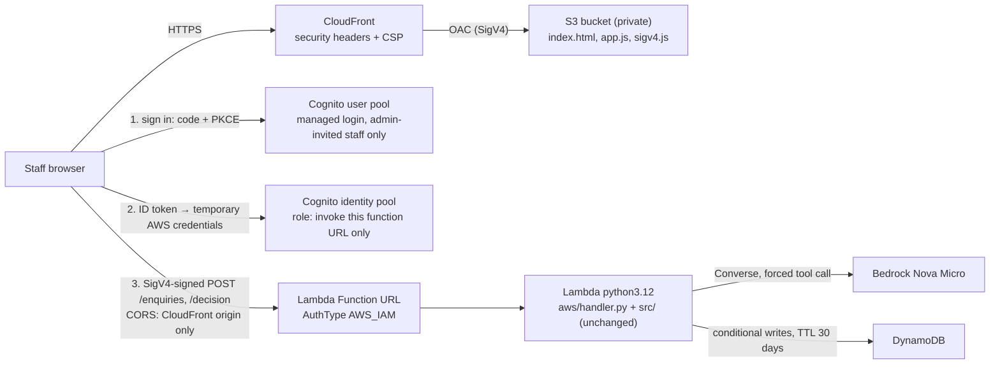

# FitDesk on AWS (optional, branch `aws-deploy`)

This branch runs the same assistant as a staff web app on AWS in `us-east-1`. Parsing uses
**Amazon Bedrock** (Amazon Nova Micro). The graded submission on `main` is the local CLI, with
Gemini as the brief requires; nothing here is needed to run or test it.

## Architecture



The staff CLI (`aws/client.py`) still works against the same function URL with your own IAM
credentials.

| Design choice | Why | Alternative not taken |
|---|---|---|
| Private S3 + CloudFront + OAC (not S3 website hosting) | HTTPS only; the bucket is never public; the bucket policy allows only this distribution; HTTP redirects to HTTPS | S3 website endpoints are HTTP-only and need a public bucket |
| Strict CSP + HSTS + nosniff + DENY framing; no third-party scripts | Limits the impact of any injected script; nothing is loaded from CDNs | n/a |
| Cognito managed login, code + PKCE, `state` + `nonce`, no client secret | AWS-recommended for browser apps; no passwords touch our code | The implicit grant is legacy |
| Admin-created users only; 12-character password policy; optional TOTP MFA | Staff tool: nobody can sign themselves up | n/a |
| Identity pool (enhanced flow, no guest access) + SigV4 in the browser | Keeps the function URL on `AWS_IAM`; credentials are short-lived and scoped | API Gateway + JWT authorizer would need a second front door |
| Least-privilege staff role | Only `lambda:InvokeFunctionUrl` (and `InvokeFunction` via the URL) on this one function | n/a |
| Tokens in `sessionStorage`, no refresh token kept, 60-minute tokens, token revocation on | A closed tab ends the session; less for an injected script to steal | `localStorage` survives tab close and is riskier |
| Model and customer text rendered with `textContent` only | No HTML injection from model output or customer messages | n/a |

## Deploy to `us-east-1`

Prerequisites: AWS CLI and SAM CLI, credentials for your project, Python 3.12.

```powershell
python aws/build.py
sam deploy -t aws/template.yaml --stack-name fitdesk-enquiry-assistant --region us-east-1 --resolve-s3 --capabilities CAPABILITY_IAM
python aws/deploy_frontend.py            # writes config.js from stack outputs, uploads, invalidates CloudFront
```

**Add a staff member.** Cognito emails them a temporary password; they set a new one at first
sign-in:

```powershell
aws cognito-idp admin-create-user --region us-east-1 --user-pool-id <UserPoolId output> --username staff@example.com --user-attributes Name=email,Value=staff@example.com Name=email_verified,Value=true --desired-delivery-mediums EMAIL
```

Then open the `FrontendUrl` output.

## Remove everything

```powershell
aws s3 rm s3://<FrontendBucketName output> --recursive
sam delete --stack-name fitdesk-enquiry-assistant --region us-east-1
```

## Verification record (20 Nov 2026)

**Backend (16:45 SAST):**

| ID | Check | Result |
|---|---|---|
| S-1 | Unsigned POST to the function URL | HTTP 403 |
| S-2 | CLI client: 12-session pack + Saturday, staff `y` | `R1,680` + all three slot statuses; stored `sent` with `decided_by` = caller ARN |
| S-3 | 20-session pack, staff `n` | Exact escalation phrase; `escalated_not_sent` |
| S-4 | Second decision on a sent enquiry | HTTP 409; status unchanged |
| S-5 | `"approve": "yes"` (not a boolean) | HTTP 400 |
| S-6 | `GET /health` | HTTP 200 |
| S-7 | CloudWatch logs | Method, path and status only; no customer text |
| S-8 | DynamoDB TTL | `expires_at` set 30 days ahead |

**Web front end (17:05 SAST):**

| ID | Check | Result |
|---|---|---|
| W-1 | `https://<distribution>/` | HTTP 200, app served |
| W-2 | Response headers | CSP, HSTS (1 year), nosniff, `X-Frame-Options: DENY`, `Referrer-Policy: no-referrer` |
| W-3 | Plain HTTP | 301 to HTTPS |
| W-4 | Direct S3 object URL | HTTP 403 (bucket private) |
| W-5 | CORS preflight from the CloudFront origin | Allowed for that origin only |
| W-6 | CORS preflight from another origin | No `Access-Control-Allow-Origin` returned |
| W-7 | Cognito authorize with the registered callback | Managed login page |
| W-8 | Cognito authorize with an unregistered `redirect_uri` | Redirect to Cognito's error page |
| W-9 | Unsigned API call after the frontend deploy | Still HTTP 403 |
| W-10 | IAM simulation of the staff role | `InvokeFunctionUrl` and `InvokeFunction` via URL allowed; direct invoke, DynamoDB, Bedrock, S3 and code changes denied |

**End to end in a real browser** (Bedrock AgentCore cloud browser, temporary test user, deleted
afterwards):

| ID | Steps | Result |
|---|---|---|
| E2E-1 | Sign in through managed login | Returned to the app signed in; ID token in `sessionStorage` only; `localStorage` empty |
| E2E-2 | Draft "How much is the 12-session pack and do you have Saturday slots?", click **Send** | Draft `12 sessions: R1,680 … 09:00: Available, 10:00: Full, 11:00: Available`; "recorded as sent"; `decided_by` = the Cognito staff role session |
| E2E-3 | Draft ` What does a 20-session pack cost?`, click **Don't send** | Exact escalation phrase; escalation notice shown; "Declined. Not sent."; 0 `` elements injected |
| E2E-4 | Sign out | Back at the Sign in screen; the Cognito session was cleared |

The browser SigV4 signer is checked against botocore in `tests/test_frontend_sigv4.py` (FE-01,
FE-02). The handler tests (AWS-01..AWS-09) also run offline as part of `python -m pytest`.
