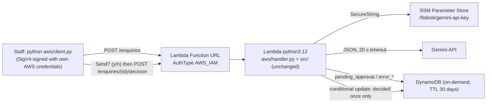

# FitDesk on AWS (optional, branch `aws-deploy`)

This branch runs the same assistant as a small staff API on AWS. The graded submission on `main`
is the local CLI only; the brief allows free tools only, so nothing here is needed to run or test it.

## Architecture



| Design choice | Why | Alternative not taken |
|---|---|---|
| Lambda (Event Functions, On-Demand) | Python handler, idle most of the time, scales to zero | Managed Instances suit continuous traffic; Web Functions are Node.js only |
| Function URL, `AWS_IAM` auth | One function and staff-only access; no public endpoint | API Gateway + Cognito gives a staff login and WAF, but needs much more setup |
| Two-step API (draft, then decision) | The human gate becomes a separate, auditable request; a conditional update means each enquiry is decided once | Step Functions `waitForTaskToken` is heavier than this needs |
| DynamoDB on-demand + TTL | Pay per request; records expire after 30 days (POPIA minimisation) | n/a |
| SSM Parameter Store SecureString | The key is never in code, environment variables or logs | Secrets Manager adds rotation, which a manually managed key doesn't need |

Logs record the method, path and status code only, never message text. Log retention is 14 days.

## Deploy (in your project's selected Region)

Prerequisites: AWS CLI and SAM CLI, credentials for your project, Python 3.12.

1. **Store the Gemini key yourself.** Don't paste it into a chat or a file:
   ```powershell
   aws ssm put-parameter --region <region> --name /fitdesk/gemini-api-key --type SecureString --value (Read-Host "Gemini API key")
   ```
2. **Build the package** (downloads Linux wheels; no Docker needed):
   ```powershell
   python aws/build.py
   ```
3. **Deploy:**
   ```powershell
   sam deploy -t aws/template.yaml --stack-name fitdesk-enquiry-assistant --region <region> --resolve-s3 --capabilities CAPABILITY_IAM --parameter-overrides GeminiModel=gemini-2.5-flash
   ```
   Copy the `FunctionUrl` output.
4. **Use it:**
   ```powershell
   pip install -r aws/requirements-client.txt
   python aws/client.py --url <FunctionUrl> "How much is the 12-session pack and do you have Saturday slots?"
   ```
   Your identity needs `lambda:InvokeFunctionUrl` and `lambda:InvokeFunction` on the function.

## Remove everything

```powershell
sam delete --stack-name fitdesk-enquiry-assistant --region <region>
aws ssm delete-parameter --region <region> --name /fitdesk/gemini-api-key
```

`sam delete` removes the function, URL, table, log group and IAM role, and the SAM artifact bucket's
objects for this stack.

## Tests

`tests/test_aws_handler.py` (AWS-01..AWS-08) runs offline with a fake DynamoDB table and a fake
Gemini, as part of `python -m pytest`.
