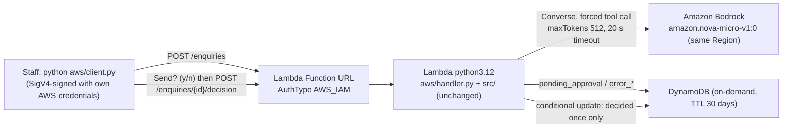

# FitDesk on AWS (optional, branch `aws-deploy`)

This branch runs the same assistant as a small staff API on AWS, using **Amazon Bedrock** (Amazon
Nova Micro) for the parsing step. The graded submission on `main` is the local CLI, with Gemini as
the brief requires. Nothing here is needed to run or test it.

## Architecture



| Design choice | Why | Alternative not taken |
|---|---|---|
| Lambda (Event Functions, On-Demand) | Python handler, idle most of the time, scales to zero | Managed Instances suit continuous traffic; Web Functions are Node.js only |
| Bedrock Nova Micro, on-demand, same Region | Cheapest text model; the IAM role authenticates, so there's no API key to store; no cross-Region inference profile | Claude Haiku needs an inference profile in `us-east-1`; Gemini needs a key in SSM (`LlmProvider=gemini`) |
| Function URL, `AWS_IAM` auth | One function and staff-only access; no public endpoint | API Gateway + Cognito gives a staff login and WAF, but needs much more setup |
| Two-step API (draft, then decision) | The human gate becomes a separate, auditable request; each enquiry is decided once | Step Functions `waitForTaskToken` is heavier than this needs |
| DynamoDB on-demand + TTL | Pay per request; records expire after 30 days (POPIA minimisation) | n/a |

The IAM role allows `bedrock:InvokeModel` on that one model ARN in the stack's Region, plus three
DynamoDB actions on the table. Logs record the method, path and status code only, never message
text. Log retention is 14 days.

## Deploy to `us-east-1`

Prerequisites: AWS CLI and SAM CLI, credentials for your project, Python 3.12.

```powershell
python aws/build.py
sam deploy -t aws/template.yaml --stack-name fitdesk-enquiry-assistant --region us-east-1 --resolve-s3 --capabilities CAPABILITY_IAM
pip install -r aws/requirements-client.txt
python aws/client.py --url <FunctionUrl output> "How much is the 12-session pack and do you have Saturday slots?"
```

Your identity needs `lambda:InvokeFunctionUrl` and `lambda:InvokeFunction` on the function.

## Remove everything

```powershell
sam delete --stack-name fitdesk-enquiry-assistant --region us-east-1
```

This removes the function, URL, table, log group, IAM role, and this stack's artifacts in the SAM
bucket.

## Tests

`tests/test_aws_handler.py` (AWS-01..AWS-09) runs offline with a fake DynamoDB table and a faked
model, as part of `python -m pytest`.
